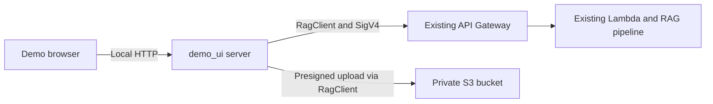
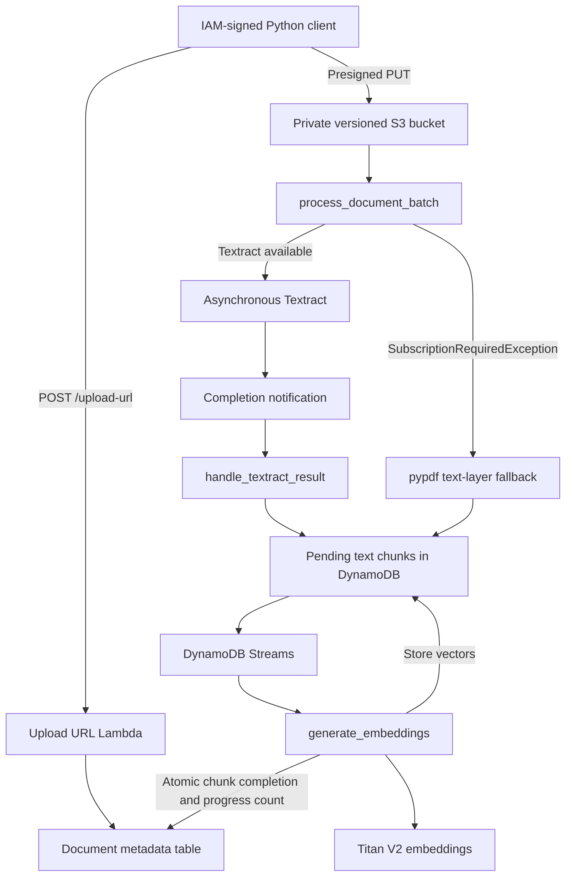
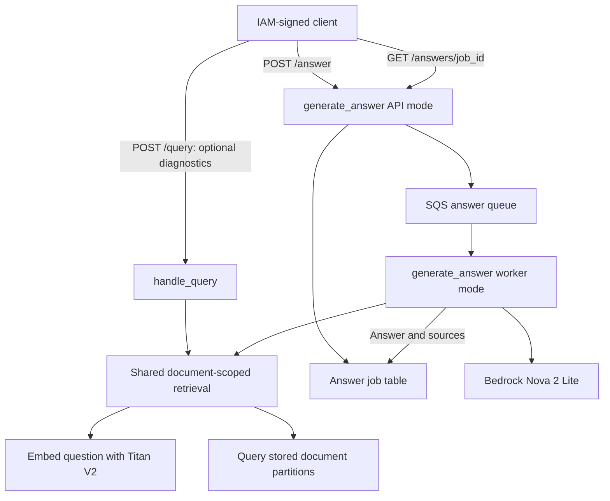

# Architecture and implementation status

Updated on 27 November 2026. The `rag-pdf` stack in `us-east-1` passed a live text-PDF upload-to-answer smoke test through the pypdf fallback. Textract OCR remains blocked and unverified. [ROADMAP.md](ROADMAP.md) tracks acceptance and remaining work.

## Evidence and scope

The imported repository contained only a notebook, manual guides, and five research PDFs; the six backend handlers were missing. Those handlers are now implemented and packaged by AWS SAM. Tests run the complete handler sequence with Moto-backed S3, DynamoDB, and SQS and controlled Textract/Bedrock responses. They verify orchestration and state, not live OCR or model quality.

The previous deployment endpoint, stored document IDs, saved outputs, upstream Git remote, and inherited active history were removed before implementation. This project has no dependency on that deployment. The research PDF files are unchanged.

Initially, no AWS profile or deployment role was available in the local evaluation workspace on 27 November 2026. A separate AWS CloudShell session in `us-east-1`, signed in as the account root identity, successfully invoked Titan V2 directly and invoked `us.amazon.nova-2-lite-v1:0` through Bedrock Converse. DeepSeek R1 invocation in the same account was blocked as a Legacy model, so the generation profile was changed to Nova 2 Lite. CloudFormation deployed the `rag-pdf` stack. The first live smoke uploaded the Transformer PDF through the API, then Textract `StartDocumentTextDetection` returned `SubscriptionRequiredException` under this account's Free plan. No billing-plan change was made. A bounded pypdf text-layer fallback was added; live testing exposed a missing starter permission to write chunks, which commit `a39914e` granted only on the chunks table. The next live smoke succeeded end to end using that fallback. A temporary local AWS login profile was configured later for the browser demo; no least-privilege deployment role has been provisioned.

At commit `a39914e`, `python -m scripts.deploy --smoke-test` from AWS CloudShell uploaded a fresh Transformer PDF (`6512893e0649491591ee0d69c68a3ff2`). The document reached `READY` with 38 chunks and `extraction_method: pypdf`. Document-scoped retrieval returned passages, and the queued Nova 2 Lite answer completed with a nonempty answer and sources from that document, including page 2 for S1 and page 5 for S2. The answer described stacked self-attention, an encoder-decoder structure, and multi-head attention with citation markers. This verifies the deployed text-PDF path through API Gateway, S3, Lambda, DynamoDB Streams, Titan, SQS, and Nova for that sample and identity. It is not a measured answer-quality benchmark. Textract OCR was neither enabled nor verified.

`scripts/local_demo.py` gives a repeatable walkthrough of the same handlers using actual text extracted from the Transformer sample PDF. Moto supplies S3, DynamoDB, and SQS; pypdf substitutes for Textract; deterministic local vector and answer functions substitute for Bedrock. It exercises orchestration, source pages, and owner isolation without cloud credentials. It does not test AWS trigger delivery, OCR, model quality, latency, or cost. [EVALUATION_GUIDE.md](docs/EVALUATION_GUIDE.md) provides the presentation flow and precise claims.

## Browser demo boundary

The browser demo is an operator-run Python server in `demo_ui/`. The browser sends a PDF and questions to that server on the same origin; the server uses the existing `RagClient` and its AWS credential chain to register/upload the PDF, poll document and answer state, and call the IAM-protected API. AWS credentials stay in the server process. The deployed API, Lambda handlers, S3 storage, and document ownership checks are unchanged. A browser session through one server uses that server's IAM principal and document scope; the demo does not provide independent user accounts or a public authentication system.

The UI shows processing states and progress before asking a question, then polls the answer job and presents the returned answer with stored source metadata. The local server is a presentation adapter, not a new cloud service. Exposing it to other people or hosting it publicly would require separate authentication, isolation, and network controls. Its launch procedure is in [DEPLOYMENT.md](docs/DEPLOYMENT.md).

On 27 November 2026, the Mac browser at `localhost:8080` used the temporary `ucs531-demo` AWS CLI profile against the deployed `us-east-1` API. The sample button uploaded the Transformer PDF as document `90cedb25809042298d83b23f8eb9711e`; the UI showed 37/38 indexed chunks and then `READY` at 38/38 with `extraction_method: pypdf`. A preset question completed with a Nova 2 Lite answer and five source cards. The S4 card expanded to show its page 5 excerpt. This verifies the browser → local signed client → deployed text-PDF path for one sample. The generated PDF page-link target was present, but new-tab navigation was not independently verified. Browser failure displays and other PDFs need separate checks.

## Ingestion pipeline

The client registers a filename and exact size before upload. Object keys use the owner hash and a fresh document ID rather than user-supplied paths. A signed content-length and content-type bind the upload request. The starter verifies the actual bytes and processes an immutable S3 version; later uploads to that key do not change an already started job.

When available, Textract starts with a deterministic request token and document ID as its job tag. The result handler checks the registered job and reads every `NextToken` page. On `SubscriptionRequiredException` only, the starter reads the accepted immutable S3 version with pypdf and extracts its existing text layer. This fallback is bounded to 10 MiB, 200 pages, and 1 million extracted characters. It rejects encrypted PDFs and fails visibly when no extractable text is found; it cannot OCR scanned or image-only pages. Both paths preserve page references and use the same 1,500-character chunks with 200-character overlap, preferring word boundaries. Deterministic chunk keys and conditional writes allow duplicate events without overwriting completed chunks. The document-status API exposes `extraction_method` as `textract` or `pypdf` after a method is selected.

The document's total chunk count is recorded before chunks are written. Embedding events process newly inserted `PENDING` chunks; updates are filtered out to avoid recursive processing. Each completion transaction changes the chunk to `COMPLETED` and increments the document counter together. Duplicate deliveries cannot double-count progress, although concurrent duplicates can repeat an external embedding call. `READY` requires all expected chunks to be completed.

Three recorded embedding failures mark the chunk/document failed; stream retries are bounded and discarded records go to a failure queue. Starter/result handlers also have asynchronous dead-letter handling. Permanent extraction errors, including a PDF without a usable text layer when OCR is unavailable, are surfaced as document failures. A hard timeout or delivery failure may require inspecting the failure queue; automated document recovery is future work.

Document states: `AWAITING_UPLOAD → EXTRACTING → EMBEDDING → READY`, with `FAILED` on recorded terminal failures. A successful S3 PUT is not readiness.

## Retrieval and answers

Retrieval checks document ownership/readiness and queries chunks by document ID rather than scanning the whole table. A caller-wide search queries the owner index for ready documents, then their chunk partitions. It is bounded to 2,500 chunks and ranks exact cosine similarity. Chunk embedding model IDs and dimensions must match the configured question model; changing dimensions requires re-ingestion.

`/query` remains useful for diagnostics. `/answer` does its own trusted retrieval and ignores client-supplied `top_chunks`; it does not accept arbitrary client text as verified sources. Long generation runs from SQS outside the API request timeout. One handler implements enqueue, polling, and worker modes so the application still has six Lambda functions.

Answer states: `QUEUED → GENERATING → COMPLETED`, or `FAILED`. The worker uses a processing lease, retries transient failures through SQS, and exposes recorded failures. Job data expires after 24 hours. A worker hard timeout can leave a job in `GENERATING` until redelivery or expiry; the client has a timeout and operational queues/logs support investigation. This is an explicit baseline limitation, not a completed recovery system.

The prompt treats passages as untrusted data, requests evidence-based answers and `[S1]` citations, and asks for abstention when evidence is insufficient. Stored source metadata is derived from retrieved chunks, including filenames and pages. Citation correctness and hallucination rates still need measured evaluation; prompt instructions are not a security or quality guarantee.

## Handler responsibilities

| Handler | Triggers and responsibilities |
| --- | --- |
| `get_presigned_url.lambda_handler` | POST upload registration; GET document status |
| `process_document_batch.lambda_handler` | S3 object creation; validate stored version; start Textract or run the bounded pypdf text fallback on `SubscriptionRequiredException` |
| `handle_textract_result.lambda_handler` | SNS Textract completion; paginate and pass page text to shared chunk persistence |
| `generate_embeddings.lambda_handler` | Filtered DynamoDB inserts; Bedrock embeddings and atomic progress |
| `handle_query.lambda_handler` | POST query; scoped exact retrieval |
| `generate_answer.lambda_handler` | POST answer, GET answer status, and SQS worker |

## Storage and identity

- **S3:** private, TLS-only, encrypted, versioned PDFs under `uploads/{owner_hash}/{document_id}/document.pdf`.
- **Documents:** primary key `document_id`; owner/creation index; immutable uploaded version, extraction method, optional Textract job correlation, counts, status, and failure message.
- **Chunks:** partition key `document_id`, sort key `chunk_id`; text, page/index metadata, status, vector, embedding model/dimensions, and retry count.
- **Answer jobs:** primary key `job_id`; owner, question/scope, status, lease, result, and 24-hour expiry.

API Gateway requires AWS IAM signatures. API resource policy rejects principals outside the stack's account. Application ownership is derived from the IAM user/role ARN; STS role sessions normalize to the same role. Users sharing a role share its document scope. Separate human accounts using one shared role require a future user-login system.

Each function has scoped data/model permissions; the embedding consumer can read only the chunk table stream and the answer consumer can receive/delete from its answer queue. A template contract test checks both event-source grants. Textract has a separate SNS publication role with account/source trust conditions and a scoped PassRole grant. Bedrock generation includes the Nova 2 Lite US inference profile, GetInferenceProfile, and its destination foundation-model ARNs. No full-access managed AWS service policy is attached to application handlers. Local template validation and the CloudShell model probes cannot establish that these permissions work for the deployed Lambda roles.

## Models, timing, and deployment

Python runtime: 3.12. Embedding model: `amazon.titan-embed-text-v2:0`, normalized 256-dimensional vectors by default. Generation profile: `us.amazon.nova-2-lite-v1:0`, with at most 4,096 output tokens. This template allows `us-east-1`, `us-east-2`, and `us-west-2` as source regions; default is `us-east-1`. The chosen cross-region profile routes within the US geography. [AWS Nova 2 Lite model card](https://docs.aws.amazon.com/bedrock/latest/userguide/model-card-amazon-nova-2-lite.html) and [Titan request schema](https://docs.aws.amazon.com/bedrock/latest/userguide/model-parameters-titan-embed-text.html).

The synchronous query has a 28-second Lambda limit and a shorter model request timeout. Answer generation has a five-minute worker limit and a longer SQS visibility timeout. Queue retries can take longer than a client polling window. [API Gateway timeout reference](https://docs.aws.amazon.com/AWSCloudFormation/latest/TemplateReference/aws-properties-apigateway-method-integration.html) and [SQS/Lambda failure handling](https://docs.aws.amazon.com/lambda/latest/dg/services-sqs-errorhandling.html).

`template.yaml` provisions all application resources. `scripts/deploy.py` verifies credentials/model definitions, validates/builds SAM, deploys the stack, exports outputs, and optionally invokes the real smoke test. The live smoke passed for a text-based PDF after the fallback and scoped permission fix. This exercises the application's Lambda model permissions on that path. Preflight and direct model probes alone would not have established them.

GitHub CI tests, lints, validates, and packages on pushes/PRs. The optional GitHub deployment workflow is designed to use short-lived OIDC credentials and a CloudFormation execution role from `infra/github-oidc.yaml`; its bootstrap resources and repository variables have not yet been provisioned. The verified stack was deployed manually from AWS CloudShell. Automatic deployment on main remains opt-in with `AUTO_DEPLOY=true`.

Logs are retained for 14 days. Failure queues have CloudWatch alarms; alarm notification destinations and account budgets are not configured. PDFs and document/chunk tables are retained on stack deletion. See [deployment instructions](docs/DEPLOYMENT.md) for setup, failure investigation, and retention behavior.

## Next acceptance gate

The live text-PDF cloud path and one browser demo flow are verified for the Transformer sample. Next, check the browser's failure display and PDF new-tab navigation, then evaluate answer and citation quality across the included papers, including unanswerable questions, and measure latency and cost. Textract OCR requires separate account access and an actual scanned-PDF test; the Free-plan `SubscriptionRequiredException` does not prove OCR works. Recovery/deletion, a possible indexed vector store, and a production multi-user web application remain follow-up work.
