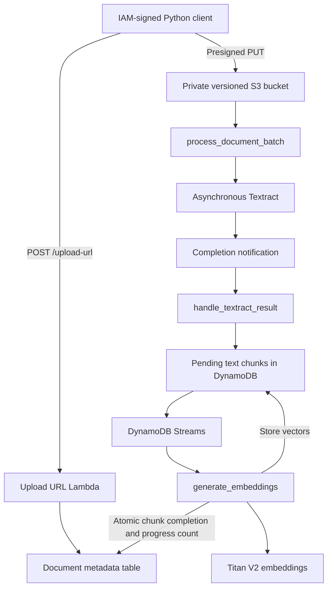
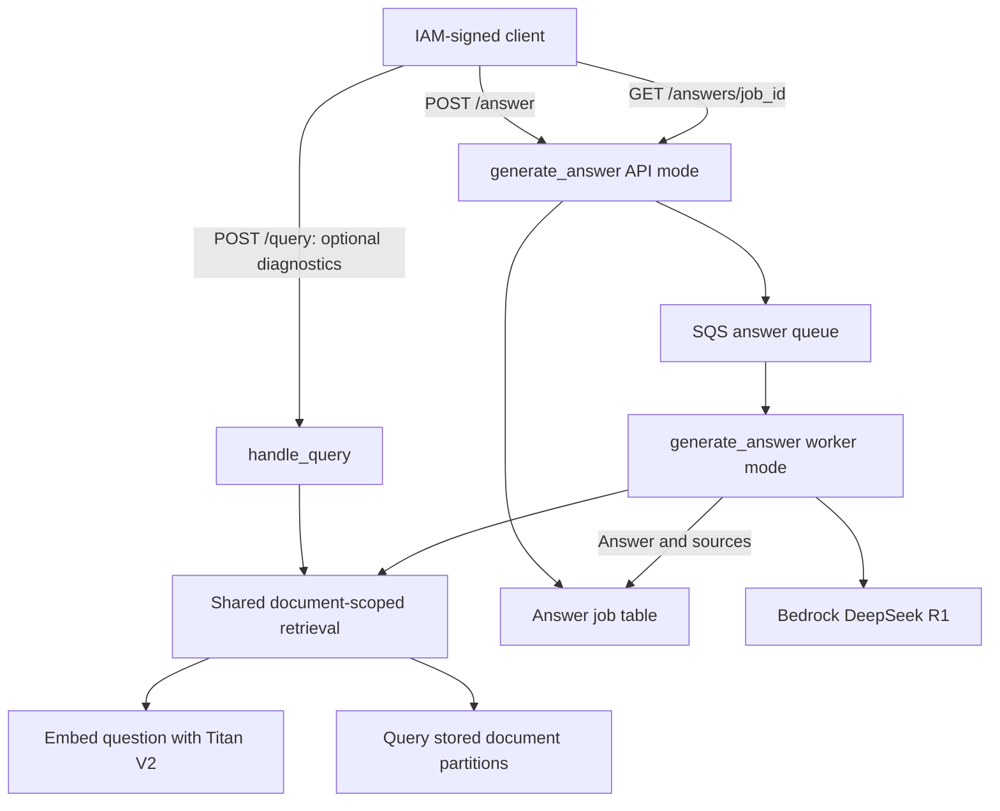

# Architecture and implementation status

Updated on 12 October 2026. This is the implemented baseline, with live AWS verification still pending account access. [ROADMAP.md](ROADMAP.md) tracks acceptance and remaining work.

## Evidence and scope

The imported repository contained only a notebook, manual guides, and five research PDFs; the six backend handlers were missing. Those handlers are now implemented and packaged by AWS SAM. Tests run the complete handler sequence with Moto-backed S3, DynamoDB, and SQS and controlled Textract/Bedrock responses. They verify orchestration and state, not live OCR or model quality.

The previous deployment endpoint, stored document IDs, saved outputs, upstream Git remote, and inherited active history were removed before implementation. This project has no dependency on that deployment. The research PDF files are unchanged.

No AWS profile or credentials were configured during implementation, so no live stack or real-model end-to-end run has been confirmed. The deployment script stops before creating resources when credentials are missing.

## Ingestion pipeline

The client registers a filename and exact size before upload. Object keys use the owner hash and a fresh document ID rather than user-supplied paths. A signed content-length and content-type bind the upload request. The starter verifies the actual bytes and processes an immutable S3 version; later uploads to that key do not change an already started job.

Textract starts with a deterministic request token and document ID as its job tag. The result handler checks the registered job, reads every `NextToken` page, preserves PDF page references, and splits each page into 1,500-character chunks with 200-character overlap, preferring word boundaries. Deterministic chunk keys and conditional writes allow duplicate extraction notifications without overwriting completed chunks.

The document's total chunk count is recorded before chunks are written. Embedding events process newly inserted `PENDING` chunks; updates are filtered out to avoid recursive processing. Each completion transaction changes the chunk to `COMPLETED` and increments the document counter together. Duplicate deliveries cannot double-count progress, although concurrent duplicates can repeat an external embedding call. `READY` requires all expected chunks to be completed.

Three recorded embedding failures mark the chunk/document failed; stream retries are bounded and discarded records go to a failure queue. Starter/result handlers also have asynchronous dead-letter handling. Permanent extraction errors are surfaced as document failures. A hard timeout or delivery failure may require inspecting the failure queue; automated document recovery is future work.

Document states: `AWAITING_UPLOAD → EXTRACTING → EMBEDDING → READY`, with `FAILED` on recorded terminal failures. A successful S3 PUT is not readiness.

## Retrieval and answers

Retrieval checks document ownership/readiness and queries chunks by document ID rather than scanning the whole table. A caller-wide search queries the owner index for ready documents, then their chunk partitions. It is bounded to 2,500 chunks and ranks exact cosine similarity. Chunk embedding model IDs and dimensions must match the configured question model; changing dimensions requires re-ingestion.

`/query` remains useful for diagnostics. `/answer` does its own trusted retrieval and ignores client-supplied `top_chunks`; it does not accept arbitrary client text as verified sources. Long generation runs from SQS outside the API request timeout. One handler implements enqueue, polling, and worker modes so the application still has six Lambda functions.

Answer states: `QUEUED → GENERATING → COMPLETED`, or `FAILED`. The worker uses a processing lease, retries transient failures through SQS, and exposes recorded failures. Job data expires after 24 hours. A worker hard timeout can leave a job in `GENERATING` until redelivery or expiry; the client has a timeout and operational queues/logs support investigation. This is an explicit baseline limitation, not a completed recovery system.

The prompt treats passages as untrusted data, requests evidence-based answers and `[S1]` citations, and asks for abstention when evidence is insufficient. Stored source metadata is derived from retrieved chunks, including filenames and pages. Citation correctness and hallucination rates still need measured evaluation; prompt instructions are not a security or quality guarantee.

## Handler responsibilities

| Handler | Triggers and responsibilities |
| --- | --- |
| `get_presigned_url.lambda_handler` | POST upload registration; GET document status |
| `process_document_batch.lambda_handler` | S3 object creation; validate stored version and start Textract |
| `handle_textract_result.lambda_handler` | SNS extraction completion; paginate, chunk, persist |
| `generate_embeddings.lambda_handler` | Filtered DynamoDB inserts; Bedrock embeddings and atomic progress |
| `handle_query.lambda_handler` | POST query; scoped exact retrieval |
| `generate_answer.lambda_handler` | POST answer, GET answer status, and SQS worker |

## Storage and identity

- **S3:** private, TLS-only, encrypted, versioned PDFs under `uploads/{owner_hash}/{document_id}/document.pdf`.
- **Documents:** primary key `document_id`; owner/creation index; immutable uploaded version, job correlation, counts, status, and failure message.
- **Chunks:** partition key `document_id`, sort key `chunk_id`; text, page/index metadata, status, vector, embedding model/dimensions, and retry count.
- **Answer jobs:** primary key `job_id`; owner, question/scope, status, lease, result, and 24-hour expiry.

API Gateway requires AWS IAM signatures. API resource policy rejects principals outside the stack's account. Application ownership is derived from the IAM user/role ARN; STS role sessions normalize to the same role. Users sharing a role share its document scope. Separate human accounts using one shared role require a future user-login system.

Each function has scoped data/model permissions; Textract has a separate SNS publication role with account/source trust conditions and a scoped PassRole grant. Bedrock generation includes the chosen inference profile, GetInferenceProfile, and its three US destination model ARNs. No full-access managed AWS service policy is attached to application handlers.

## Models, timing, and deployment

Python runtime: 3.12. Embedding model: `amazon.titan-embed-text-v2:0`, normalized 256-dimensional vectors by default. Generation profile: `us.deepseek.r1-v1:0`, with at most 4,096 output tokens. Supported source regions are US East 1/2 and US West 2; default `us-east-1`. Cross-region routing remains within the profile's US geography. [AWS model card](https://docs.aws.amazon.com/en_en/bedrock/latest/userguide/model-card-deepseek-deepseek-r1.html) and [Titan request schema](https://docs.aws.amazon.com/bedrock/latest/userguide/model-parameters-titan-embed-text.html).

The synchronous query has a 28-second Lambda limit and a shorter model request timeout. Answer generation has a five-minute worker limit and a longer SQS visibility timeout. Queue retries can take longer than a client polling window. [API Gateway timeout reference](https://docs.aws.amazon.com/AWSCloudFormation/latest/TemplateReference/aws-properties-apigateway-method-integration.html) and [SQS/Lambda failure handling](https://docs.aws.amazon.com/lambda/latest/dg/services-sqs-errorhandling.html).

`template.yaml` provisions all application resources. `scripts/deploy.py` verifies credentials/model definitions, validates/builds SAM, deploys the stack, exports outputs, and optionally invokes the real smoke test. Preflight does not prove Lambda model permissions; the real smoke test does.

GitHub CI tests, lints, validates, and packages on pushes/PRs. Deployment uses short-lived GitHub OIDC credentials and a CloudFormation execution role from `infra/github-oidc.yaml`. The bootstrap script can configure repository variables. Manual deployment is available; automatic deployment on main is opt-in with `AUTO_DEPLOY=true`. AWS bootstrap/roles have not yet been provisioned.

Logs are retained for 14 days. Failure queues have CloudWatch alarms; alarm notification destinations and account budgets are not configured. PDFs and document/chunk tables are retained on stack deletion. See [deployment instructions](docs/DEPLOYMENT.md) for setup, failure investigation, and retention behavior.

## Next acceptance gate

Configure AWS account access, provision the stack, and run the sample PDF through live Textract and Bedrock. Only after that succeeds can the cloud flow be considered verified. Then evaluate answer quality, add recovery/deletion, and decide whether corpus size warrants an indexed vector store or a browser interface.
