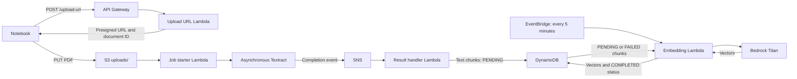
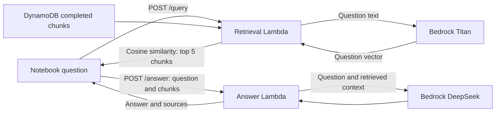

# Architecture and implementation review

Reviewed on 12 October 2026. This document distinguishes included client code from the backend described in the guides. Proposed improvements are tracked in [ROADMAP.md](ROADMAP.md).

## Scope and evidence

The application is intended to answer questions about uploaded PDFs using AWS services. The notebook is the only executable application code in the repository. All seven original Markdown files and all notebook cells were reviewed; the Git history was checked for missing backend files. The five PDF samples were identified from their first pages and PDF metadata.

The initial notebook contained recorded successful uploads and four recorded question-answer runs. Those outputs indicate a previous demonstration but do not verify a current deployment, backend correctness, or retrieval quality. Saved outputs and deployment-specific settings have been cleared. No request was sent to the imported deployment, and no AWS resource was created or changed during this review.

## What is present

| Artifact | Verified contents and limitations |
| --- | --- |
| Notebook cell 1 | `get_upload_url`, `upload_file_to_s3`, and `upload_document`; obtains a presigned URL and document ID and sends a PUT request containing the PDF. |
| Notebook cell 2 | Batch upload loop over five bundled PDFs; stores returned IDs in `document_ids`. |
| Notebook cell 3 | `test_full_rag_pipeline`; calls `/query` with a question, optional document ID, and `top_k=5`, then forwards returned chunks to `/answer`. Prints answer, filenames, chunk indexes, similarity scores, and excerpts. |
| Notebook cell 4 | Four example questions scoped to the uploaded Transformer paper; pauses one second between questions. |
| Notebook cell 5 | Empty code cell. |
| Setup guides | Console instructions for S3, DynamoDB, IAM, API Gateway, SNS, Textract-triggering Lambdas, and EventBridge. Backend code is referenced, not embedded. |
| Sample questions | Questions covering each paper and cross-document questions. No expected answers or automated assertions. |
| PDFs | Transformer: 15 pages; ResNet: 12; GANs: 9; BERT: 16; LLM survey: 144. They are a demonstration corpus, not model training data. |

No `lambda_functions/` directory or backend Python files exist in the imported snapshot or its copied commit history. There is also no deployment template, dependency manifest, automated test suite, CI workflow, browser interface, or tracked AWS configuration for this account.

## Document ingestion: documented design

The asynchronous Textract job avoids waiting for a long PDF extraction inside the upload request. SNS carries a completion notification; the result handler must fetch the actual text using the job ID. The guide specifies an `uploads/` prefix and `.pdf` suffix for S3 events. It does not provide the code that creates object keys, correlates jobs to documents, paginates results, or splits text.

Chunk statuses are described as `PENDING`, `FAILED`, and `COMPLETED`. There is no implemented document-level readiness API. A successful S3 PUT establishes upload completion only. The guide's suggested 5–10 minute wait is not a verified completion guarantee.

## Question answering: documented design

Embeddings represent text numerically so that a question can be compared with document passages. Retrieval selects passages; generation uses those passages to draft the answer. This workflow does not train or fine-tune a model.

The notebook supports an optional `document_id`; `None` requests a corpus-wide search. Backend filtering and ownership enforcement cannot be checked because the retrieval source is absent. The answer request accepts the chunks returned through the client, so the proposed backend should retrieve or validate trusted context rather than treat arbitrary client text as verified document evidence.

## Missing backend components

| Expected file | Intended responsibility |
| --- | --- |
| `lambda_functions/get_presigned_url.py` | Validate an upload request, create a document ID and S3 key, return a presigned PUT URL. |
| `lambda_functions/process_document_batch.py` | Handle S3 events and start Textract jobs. |
| `lambda_functions/handle_textract_result.py` | Process completion events, retrieve all Textract pages, chunk text, and persist chunks. |
| `lambda_functions/generate_embeddings.py` | Generate and store embeddings and update chunk status. |
| `lambda_functions/handle_query.py` | Embed a question, filter eligible chunks, rank similarity, and return candidates. |
| `lambda_functions/generate_answer.py` | Build grounded prompts, invoke the selected model, and return answers and sources. |

The query guide also uses the filename `generate-answer.py` in one place. Select one Python filename convention when implementing and make the guides match the packaged source.

## Findings to resolve before deployment

1. **Reproducibility:** a new checkout cannot deploy the described backend. Implement the missing source with dependency declarations and a single infrastructure template. The README now lists only files that actually exist.
2. **Database access:** the guide makes `chunk_id` the partition key and `document_id` the sort key, which does not support fetching a document's chunks by document ID alone. Design keys or an index around document access. The documented retriever scans stored vectors and computes similarity in Lambda; storing vectors in DynamoDB does not implement an indexed vector search. Full scans grow with the corpus and require pagination. [AWS Scan documentation](https://docs.aws.amazon.com/amazondynamodb/latest/APIReference/API_Scan.html) explains the 1 MB page boundary; [AWS scan guidance](https://docs.aws.amazon.com/amazondynamodb/latest/developerguide/Scan.html) explains that filters apply after reading and do not reduce that read capacity.
3. **Job reliability:** define document states, job correlation, deterministic chunk IDs, duplicate-event handling, bounded retries, and failed-job recovery. Textract retrieval requires handling `NextToken`, and its asynchronous API supports an idempotency token. [AWS asynchronous Textract documentation](https://docs.aws.amazon.com/textract/latest/dg/api-async.html).
4. **Permissions:** the guides share a broad execution role between Lambda and Textract and attach several full-access policies. The listed setup does not specify the `iam:PassRole` permission needed to pass the Textract notification role. Separate roles, scope permissions to resources, and constrain the Textract trust policy. [AWS Textract role configuration](https://docs.aws.amazon.com/textract/latest/dg/api-async-roles.html) documents PassRole and trust conditions; [AmazonTextractFullAccess](https://docs.aws.amazon.com/aws-managed-policy/latest/reference/AmazonTextractFullAccess.html) grants `textract:*`, not PassRole. The guide's custom SNS policy explicitly scopes its topic; keep that scope if using its topic name instead of the AWS managed service-role topic pattern.
5. **Public API controls:** no authentication, user ownership checks, throttling plan, upload-size limits, or request validation is included. Absence of backend code prevents checking the previous deployment's protections. Define these controls before deploying this account's endpoints.
6. **Timing:** the guides specify two-minute retrieval and one-minute answer Lambda timeouts, without configuring API Gateway integration timeouts. A Lambda timeout does not extend the API integration timeout. AWS documents a default of 29 seconds, with increases available for Regional/private REST APIs. [AWS integration timeout documentation](https://docs.aws.amazon.com/AWSCloudFormation/latest/TemplateReference/aws-properties-apigateway-method-integration.html). Configure the full request path deliberately.
7. **Model configuration:** Titan and DeepSeek are named but exact model IDs, vector dimensions, and invocation schemas are absent. Verify region availability and account access before deployment; record the chosen embedding version so re-indexing is controlled. [AWS supported-model documentation](https://docs.aws.amazon.com/bedrock/latest/userguide/models-supported.html).
8. **Client reliability:** notebook HTTP calls have no explicit timeouts, uploads read whole files into memory, and error handling mainly prints messages. Upload parsing assumes a possible nested `body` and needs contract tests for plain API JSON and Lambda test envelopes. In a standard proxy integration API Gateway exposes the Lambda response body to the HTTP client. [AWS proxy integration documentation](https://docs.aws.amazon.com/apigateway/latest/developerguide/set-up-lambda-proxy-integrations.html).
9. **Answer quality:** recorded examples included reference-list passages among top results and an abstention for a broad summary question. This motivates relevance evaluation, structure-aware chunks with overlap and page metadata, and possibly reranking. Similarity scores alone are not correctness metrics and should not be assigned an arbitrary universal threshold.
10. **Operations:** logging, metrics, alarms, budgets, retention/deletion, and deployment teardown are not specified in executable infrastructure. Add them to the same deployment pipeline rather than as detached features.

## Recommended development direction

Keep the asynchronous ingestion and notebook client as the first demonstrable baseline. Implement one coherent upload → extraction → embedding → retrieval → answer path under this project's AWS account and test it using the supplied papers.

For a small course demonstration, a paginated, document-scoped exact similarity implementation may be sufficient. Measure its latency and cost before adding a dedicated vector index. For a larger corpus, introduce a retrieval abstraction and evaluate a managed vector index against the same questions. Replace scheduled full-table embedding discovery with an event-driven queue when reliability or processing delay warrants it.

Add document readiness and server-side answer orchestration before a browser interface. Keep any future interface on the same API and document store. The proposed changes in this section have not been implemented.
