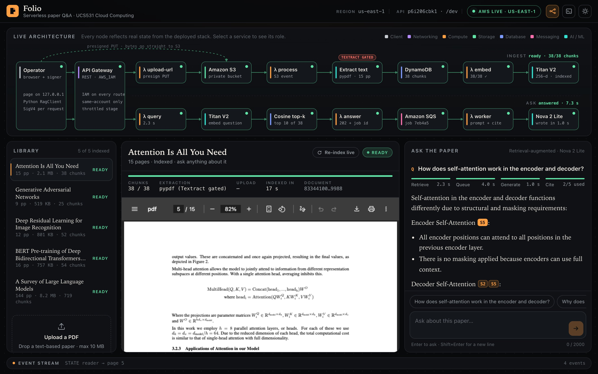
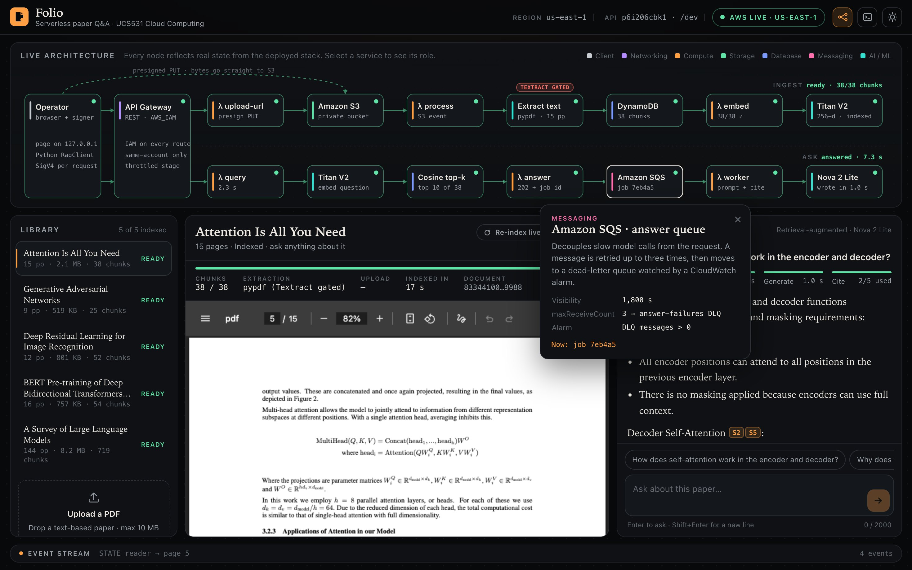
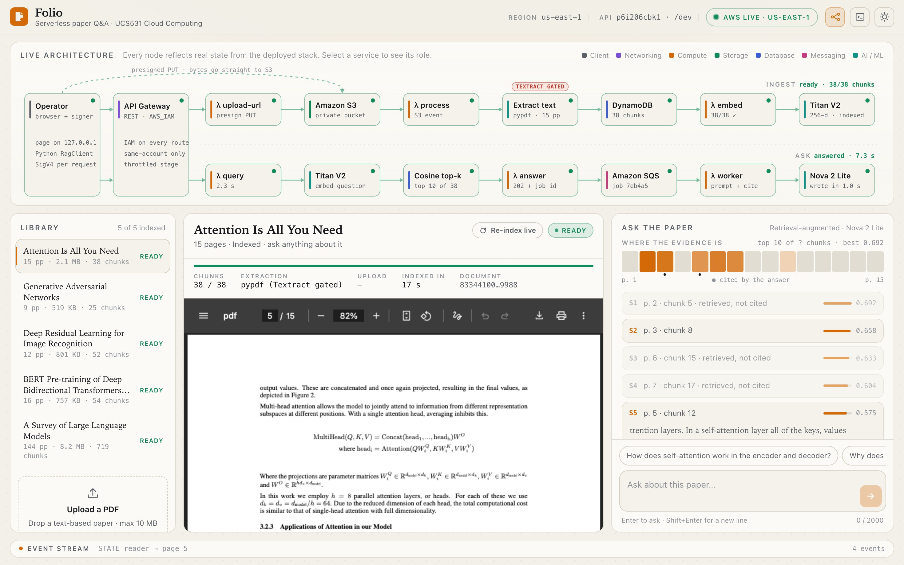
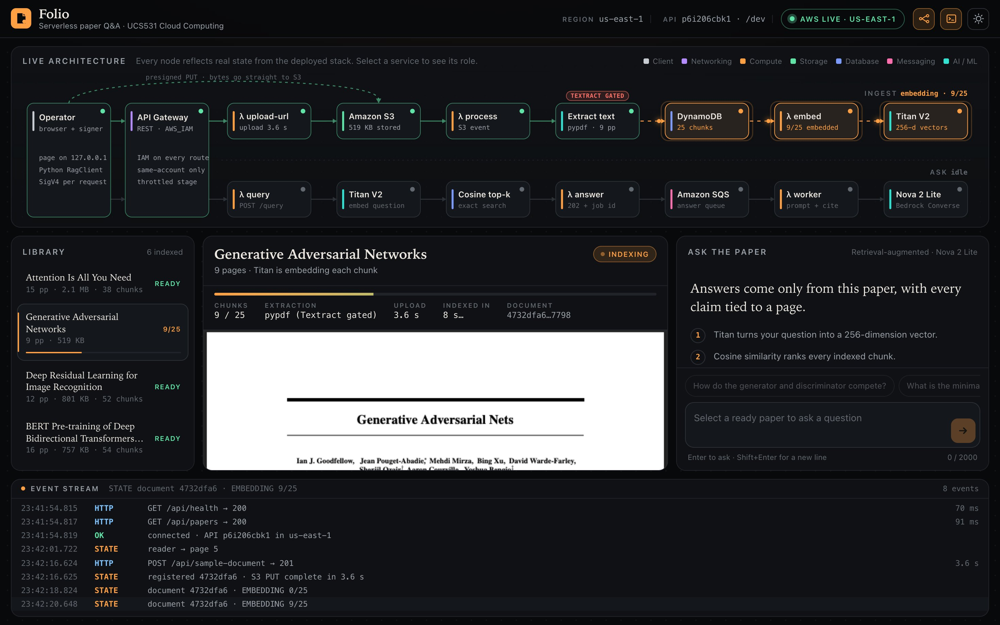

# Folio: serverless PDF Q&A on AWS

Upload a research paper, watch AWS index it, then ask questions. Answers are generated only from retrieved passages of that paper, and every claim carries a page citation you can click.



**AWS services:** API Gateway (IAM auth) · six Lambda functions · S3 · Textract with a pypdf fallback · DynamoDB + Streams · SQS · Bedrock (Titan Text Embeddings V2, Nova 2 Lite) · CloudWatch · all declared in one AWS SAM template. Private repository: [aryanorastar/UCS531-Cloud-Computing-Project](https://github.com/aryanorastar/UCS531-Cloud-Computing-Project). Course: UCS531 Cloud Computing.

## Run the demo

```sh
aws login --profile ucs531-demo --region us-east-1
.venv/bin/python -m demo_ui.server --profile ucs531-demo \
  --api-url https://p6i206cbk1.execute-api.us-east-1.amazonaws.com/dev
```

Open <http://127.0.0.1:8080>. Set up `.venv` first with [Quick start](#quick-start). The server calls the live stack, so indexing and answers use (cheap) billable AWS services. Stop it with Ctrl+C.

## What the interface shows

| Area | What it does | Data source |
| --- | --- | --- |
| **Live architecture** | Sixteen service nodes on the ingest and ask paths light up, animate and show live numbers (chunks embedded, retrieval time, generation time). Select a node to see its role and configuration. | Document and answer-job states polled from the API; configuration from `template.yaml` |
| **Library** | The five bundled papers with one-click indexing, your own PDF uploads, and reopening any document ID | Local list in `.demo/library.json` plus live status per document |
| **Reader** | The PDF itself. Clicking a citation jumps to its page. | Bundled PDF, or a local copy of your upload |
| **Ask thread** | Retrieve → Queue → Generate → Cite timeline with measured timings, an answer with clickable `[S1]` chips, and a hover preview of each passage | `/query` (top 10 with cosine scores) and the `/answer` job |
| **Where the evidence is** | A heat strip across every page showing how close each page's best chunk is to the question. Dots mark pages the answer actually cites; retrieved but uncited passages are dimmed. | `similarity_score` from retrieval |
| **Event stream** | A CloudWatch-style log of every call and state transition with its latency | Measured in the browser |
| **Re-index live** | Uploads a bundled paper again as a new document so the whole ingest path can be watched (the 9-page GAN paper takes about 10–15 s) | Real upload |
| **Off-topic test** | Asks a question the paper cannot answer. A grounded system declines. | Real answer |

Keys: `/` ask · `` ` `` event stream · `A` architecture · `T` light or dark theme.

| Service card (SQS) | Evidence view, light theme |
| --- | --- |
|  |  |



The browser never receives AWS credentials. The page talks to a localhost-only Python server, which signs every request with SigV4 through `RagClient`. It accepts writes only from its own origin and refuses to bind to anything except localhost. It is an operator demo, not a public multi-user site.

## Verified live (27 November 2026, `us-east-1`)

| Check | Result |
| --- | --- |
| All five bundled papers indexed by the deployed stack | Transformer 38 chunks in 17 s · BERT 54 in 30 s · ResNet 52 in 19 s · GAN 25 in 18 s (live re-index: 10–13 s) · LLM Survey, 144 pages → 719 chunks in 283 s. All used the pypdf text layer. |
| Question → cited answer in the browser | "How does self-attention work in the encoder and decoder?" answered in 7.3 s, citing pages 3 and 5 of the Transformer paper |
| Grounding check | "Who won the 2022 FIFA World Cup?" asked of the GAN paper returned "the documents do not provide enough evidence" in 3.2 s |
| Command-line smoke test | `scripts/smoke_test.py` passed upload → `READY` → retrieval → Nova answer from AWS CloudShell at commit `a39914e` |
| Textract OCR | **Blocked.** `StartDocumentTextDetection` returns `SubscriptionRequiredException` on this account's Free plan, so scanned (image-only) PDFs cannot be read. No billing change was made. |
| Local tests | 46 pass, with S3/DynamoDB/SQS simulated by moto and Bedrock/Textract responses stubbed |

These runs show the pipeline works on real papers. They are not an accuracy benchmark; measuring citation correctness across many questions is future work. Details: [ARCHITECTURE.md](ARCHITECTURE.md), [ROADMAP.md](ROADMAP.md).

## Lab presentation

[Five-minute evaluation guide](docs/EVALUATION_GUIDE.md) (demo script and likely viva questions) · [eleven-slide PDF](presentation/UCS531_Lab_Evaluation.pdf) · [editable PowerPoint](presentation/UCS531_Lab_Evaluation.pptx).

## Full flow

1. An IAM-signed request to `POST /upload-url` registers a document and returns a 15-minute presigned S3 PUT URL.
2. The client streams the PDF into a private, versioned bucket using the returned headers.
3. `process_document_batch` verifies the stored version's size and PDF header. It starts an idempotent Textract job when available; if Textract returns `SubscriptionRequiredException`, it extracts an existing PDF text layer with bounded pypdf processing. The fallback does not perform OCR.
4. Textract's result handler, or the fallback in the starter, creates overlapping text chunks with page references and writes deterministic pending chunks.
5. DynamoDB Streams invokes `generate_embeddings` immediately. Chunk completion and the document's progress counter are committed atomically. When all chunks are indexed, document status becomes `READY`.
6. `POST /query` returns relevant passages using exact cosine similarity within the caller's document scope.
7. `POST /answer` queues a job and returns HTTP 202. The worker retrieves trusted passages itself, invokes Nova 2 Lite, and stores an answer with source metadata. The client polls `GET /answers/{job_id}`.

## Quick start

Use Python 3.12:

```sh
python3.12 -m venv .venv
source .venv/bin/activate
python -m pip install -r requirements-dev.txt
pytest -q
python -m scripts.local_demo
sam validate --lint --region us-east-1
sam build --region us-east-1
```

If `python3.12` is unavailable but `uv` is installed, create the environment with `uv venv --seed --python 3.12 .venv`, activate it, and run `uv pip install -r requirements-dev.txt` before the commands above. `--seed` installs pip inside the environment, which SAM needs for its build.

The local demo prints each state transition, retrieved page references, an extractive answer, and an owner-isolation check. It uses real text from the included Transformer PDF; Moto replaces S3/DynamoDB/SQS, and deterministic stand-ins replace Titan and Nova 2 Lite. The deployed fallback also uses pypdf to read a PDF text layer if Textract is unavailable. **The local demo by itself is not evidence of live OCR, model accuracy, or cloud integration; the separate live smoke result above covers the text-PDF path.** Pass `--pdf` and `--question` to try another text-based PDF and question.

To deploy a new stack using an authorized AWS profile and then run the sample PDF:

```sh
python -m scripts.deploy --smoke-test
```

This provisions billable AWS resources and performs Textract/model calls. For the existing `rag-pdf` stack, use `python -m scripts.smoke_test --api-url "$RAG_API_BASE_URL"` after setting the API output URL. The default region is `us-east-1`, with `amazon.titan-embed-text-v2:0` and the `us.amazon.nova-2-lite-v1:0` US cross-region inference profile. The template supports `us-east-1`, `us-east-2`, and `us-west-2` as source regions; this US profile is not the original Mumbai deployment path. [AWS's Nova 2 Lite model card](https://docs.aws.amazon.com/bedrock/latest/userguide/model-card-amazon-nova-2-lite.html) describes the profile and its routing regions.

The script exports stack outputs to ignored `deployment.json`. Set `RAG_API_BASE_URL` to its `ApiBaseUrl` output, including the stage, before using the notebook or client. API calls use your AWS credential chain and require `execute-api:Invoke` permission. [Deployment and GitHub OIDC setup](docs/DEPLOYMENT.md) explains account prerequisites, setup, and teardown.

## Client example

```python
from client import RagClient

rag = RagClient()  # RAG_API_BASE_URL and default AWS profile
identifier = rag.upload("pdfs/Attention Is All You Need.pdf")
rag.wait_document(identifier)
result = rag.answer("How does the Transformer use attention?", identifier)
print(result["answer"])
print(result["sources"])
```

`index.ipynb` uses this same client. It supports batch uploads, readiness polling, retrieval diagnostics, and answer polling. To use a named profile, set `AWS_PROFILE` or pass `profile=` to `RagClient` and deployment commands. Notebook outputs stay cleared in Git.

## Repository

| Path | Responsibility |
| --- | --- |
| `lambda_functions/` | Six handlers, shared contracts/retrieval code, and packaged dependencies |
| `template.yaml` | Complete SAM application infrastructure and scoped execution policies |
| `client.py` | IAM signing, streamed uploads, readiness checks, and answer polling |
| `demo_ui/` | Folio: operator-run browser interface (live architecture, library, PDF reader, cited Q&A) and its localhost signing proxy |
| `scripts/deploy.py` | Credential/model preflight, build/deploy, stack outputs, optional live smoke test |
| `scripts/smoke_test.py` | Real upload-to-answer verification against a deployed API |
| `scripts/local_demo.py` | Offline, step-by-step handler demonstration using actual PDF text and simulated services |
| `scripts/bootstrap_github.py` | One-time AWS OIDC bootstrap and optional GitHub variable configuration |
| `infra/github-oidc.yaml` | OIDC trust, deployment roles, and private artifact bucket |
| `.github/workflows/` | Tests/build and optional automated AWS deployment |
| `tests/` | AWS-simulated integration, contracts, isolation, and failure checks |
| `docs/` | Deployment, API contracts, ingestion, and notebook guides |
| `pdfs/` | Five unchanged research papers for demonstrations |

## Baseline limits

The default limits are 25 MiB per PDF, 500 Textract pages, 2,000 chunks per document, and 2,500 chunks per search. The pypdf fallback is narrower: 10 MiB, 200 pages, and 1 million extracted characters; encrypted or image-only PDFs cannot use it. `GET /documents/{id}` reports `extraction_method` as `textract` or `pypdf` when selected. Retrieval is an exact document-partition query, not an indexed vector database. Ownership is per IAM user or role; sessions of the same role share that scope. The browser demo inherits its server's IAM identity and reads PDFs at most 10 MiB (the fallback's limit); stronger multi-user login, a production-hosted interface, document deletion, and measured answer-quality evaluation remain future work.

[Lab evaluation guide](docs/EVALUATION_GUIDE.md) · [Upload API](docs/2-Upload_Endpoint.md) · [Ingestion](docs/3-Data_Ingestion.md) · [Query and answer APIs](docs/4-RAG_Query_API.md) · [Notebook usage](docs/5-Testing_Scripts.md) · [Sample questions](docs/Sample_Questions.md)
