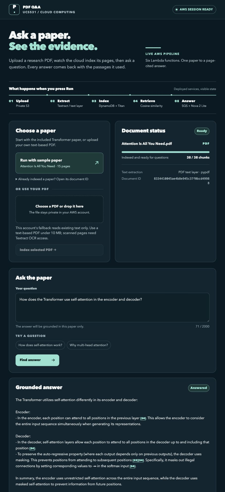

# Serverless PDF Q&A on AWS

Private repository: [aryanorastar/UCS531-Cloud-Computing-Project](https://github.com/aryanorastar/UCS531-Cloud-Computing-Project).

Upload a PDF, wait for text extraction and indexing, and ask questions answered from retrieved passages. The backend uses S3, Textract when available, a bounded text-PDF fallback when it is not, DynamoDB, Bedrock Titan embeddings, and Bedrock Amazon Nova 2 Lite answers.

## Current status

All six Lambda handlers, the shared client, an AWS SAM deployment, integration tests, and GitHub Actions workflows are implemented. Local tests simulate AWS storage and events and stub Textract/Bedrock responses; they do not validate a live model. The SAM template validates and packages for Python 3.12. A separate local demonstration parses text from an actual sample PDF and exercises the handlers with simulated AWS services and deterministic model substitutes.

**The live text-PDF path passed.** On 27 November 2026, the deployed `rag-pdf` stack in `us-east-1` passed the full sample-PDF upload-to-answer smoke test from AWS CloudShell at code commit `a39914e`. A fresh Transformer PDF reached `READY` with **38 chunks** using `extraction_method: pypdf`; document-scoped retrieval passed; Nova 2 Lite returned a nonempty answer with source pages from that PDF. The run exercised the deployed API, S3, Lambda roles, DynamoDB/Streams, Titan, SQS, and Nova answer polling. Earlier, Textract `StartDocumentTextDetection` returned `SubscriptionRequiredException` under this account's Free plan, so **Textract OCR remains blocked and unverified**; no billing-plan change was made. The fallback reads an existing text layer and cannot OCR scanned PDFs. A temporary local AWS login profile is now configured for the browser demo; a least-privilege deployment role is not. The repository remains private. See [ARCHITECTURE.md](ARCHITECTURE.md) and [ROADMAP.md](ROADMAP.md) for evidence and remaining work.

## Lab presentation

Use the [nine-slide PDF](presentation/UCS531_Lab_Evaluation.pdf) for a reliable preview or the [editable PowerPoint](presentation/UCS531_Lab_Evaluation.pptx) to present. The [five-minute evaluation guide](docs/EVALUATION_GUIDE.md) supplies the speaking order, demo commands, likely examiner questions, and the exact boundary of the live verification.

## Browser demo

`demo_ui/` adds a browser presentation layer over the existing AWS pipeline. An operator starts its Python server with AWS credentials and the deployed `RAG_API_BASE_URL`; the page then uploads a PDF, shows extraction/indexing status, asks a question, and displays the answer with source page numbers and excerpts. The browser calls the local server, which uses `RagClient` to sign requests to the IAM-protected API. AWS credentials are not embedded in JavaScript. This is an operator-controlled demo, with no separate public login or multi-user isolation. See [run instructions](docs/DEPLOYMENT.md) and the [five-minute UI walkthrough](docs/EVALUATION_GUIDE.md).

**The live browser path passed on 27 November 2026.** From `localhost:8080` on the evaluation Mac using the temporary `ucs531-demo` AWS login profile, the sample button uploaded the Transformer PDF as document `90cedb25809042298d83b23f8eb9711e`. The UI displayed indexing at 37/38, then `READY` at 38/38 via `pypdf`. A preset question completed through Nova 2 Lite and displayed five source cards; source S4's page 5 excerpt was expanded. After the UI race fix, a second sample upload initially showed a transient AWS request error. Retrying in the same page produced document `8334410045ae4b8e945c37f0bcd49988`, again `READY` at 38/38, and another cited answer. These are live browser-to-AWS runs, not a quality benchmark. A PDF page link was rendered but opening its new tab was not independently verified.



[See the expanded page 5 source excerpt](docs/assets/source-pages.jpg).

From the repository root on the evaluation Mac, with the Python environment from [Quick start](#quick-start):

```sh
aws login --profile ucs531-demo --region us-east-1
RAG_API_BASE_URL=https://p6i206cbk1.execute-api.us-east-1.amazonaws.com/dev \
  .venv/bin/python -m demo_ui.server --profile ucs531-demo
```

Open `http://127.0.0.1:8080`. The sample-paper button provides the fastest walkthrough. This command calls the existing live stack and can use billable AWS services; the local UI server stops with Ctrl+C.

## Full flow

1. An IAM-signed request to `POST /upload-url` registers a document and returns a 15-minute presigned S3 PUT URL.
2. The client streams the PDF into a private, versioned bucket using the returned headers.
3. `process_document_batch` verifies the stored version's size and PDF header. It starts an idempotent Textract job when available; if Textract returns `SubscriptionRequiredException`, it extracts an existing PDF text layer with bounded pypdf processing. The fallback does not perform OCR.
4. Textract's result handler, or the fallback in the starter, creates overlapping text chunks with page references and writes deterministic pending chunks.
5. DynamoDB Streams invokes `generate_embeddings` immediately. Chunk completion and the document's progress counter are committed atomically. When all chunks are indexed, document status becomes `READY`.
6. `POST /query` returns relevant passages using exact cosine similarity within the caller's document scope.
7. `POST /answer` queues a job and returns HTTP 202. The worker retrieves trusted passages itself, invokes Nova 2 Lite, and stores an answer with source metadata. The client polls `GET /answers/{job_id}`.

## Quick start

Use Python 3.12:

```sh
python3.12 -m venv .venv
source .venv/bin/activate
python -m pip install -r requirements-dev.txt
pytest -q
python -m scripts.local_demo
sam validate --lint --region us-east-1
sam build --region us-east-1
```

If `python3.12` is unavailable but `uv` is installed, create the environment with `uv venv --seed --python 3.12 .venv`, activate it, and run `uv pip install -r requirements-dev.txt` before the commands above. `--seed` installs pip inside the environment, which SAM needs for its build.

The local demo prints each state transition, retrieved page references, an extractive answer, and an owner-isolation check. It uses real text from the included Transformer PDF; Moto replaces S3/DynamoDB/SQS, and deterministic stand-ins replace Titan and Nova 2 Lite. The deployed fallback also uses pypdf to read a PDF text layer if Textract is unavailable. **The local demo by itself is not evidence of live OCR, model accuracy, or cloud integration; the separate live smoke result above covers the text-PDF path.** Pass `--pdf` and `--question` to try another text-based PDF and question.

To deploy a new stack using an authorized AWS profile and then run the sample PDF:

```sh
python -m scripts.deploy --smoke-test
```

This provisions billable AWS resources and performs Textract/model calls. For the existing `rag-pdf` stack, use `python -m scripts.smoke_test --api-url "$RAG_API_BASE_URL"` after setting the API output URL. The default region is `us-east-1`, with `amazon.titan-embed-text-v2:0` and the `us.amazon.nova-2-lite-v1:0` US cross-region inference profile. The template supports `us-east-1`, `us-east-2`, and `us-west-2` as source regions; this US profile is not the original Mumbai deployment path. [AWS's Nova 2 Lite model card](https://docs.aws.amazon.com/bedrock/latest/userguide/model-card-amazon-nova-2-lite.html) describes the profile and its routing regions.

The script exports stack outputs to ignored `deployment.json`. Set `RAG_API_BASE_URL` to its `ApiBaseUrl` output, including the stage, before using the notebook or client. API calls use your AWS credential chain and require `execute-api:Invoke` permission. [Deployment and GitHub OIDC setup](docs/DEPLOYMENT.md) explains account prerequisites, setup, and teardown.

## Client example

```python
from client import RagClient

rag = RagClient()  # RAG_API_BASE_URL and default AWS profile
identifier = rag.upload("pdfs/Attention Is All You Need.pdf")
rag.wait_document(identifier)
result = rag.answer("How does the Transformer use attention?", identifier)
print(result["answer"])
print(result["sources"])
```

`index.ipynb` uses this same client. It supports batch uploads, readiness polling, retrieval diagnostics, and answer polling. To use a named profile, set `AWS_PROFILE` or pass `profile=` to `RagClient` and deployment commands. Notebook outputs stay cleared in Git.

## Repository

| Path | Responsibility |
| --- | --- |
| `lambda_functions/` | Six handlers, shared contracts/retrieval code, and packaged dependencies |
| `template.yaml` | Complete SAM application infrastructure and scoped execution policies |
| `client.py` | IAM signing, streamed uploads, readiness checks, and answer polling |
| `demo_ui/` | Operator-run browser interface and local proxy through the existing signed client |
| `scripts/deploy.py` | Credential/model preflight, build/deploy, stack outputs, optional live smoke test |
| `scripts/smoke_test.py` | Real upload-to-answer verification against a deployed API |
| `scripts/local_demo.py` | Offline, step-by-step handler demonstration using actual PDF text and simulated services |
| `scripts/bootstrap_github.py` | One-time AWS OIDC bootstrap and optional GitHub variable configuration |
| `infra/github-oidc.yaml` | OIDC trust, deployment roles, and private artifact bucket |
| `.github/workflows/` | Tests/build and optional automated AWS deployment |
| `tests/` | AWS-simulated integration, contracts, isolation, and failure checks |
| `docs/` | Deployment, API contracts, ingestion, and notebook guides |
| `pdfs/` | Five unchanged research papers for demonstrations |

## Baseline limits

The default limits are 25 MiB per PDF, 500 Textract pages, 2,000 chunks per document, and 2,500 chunks per search. The pypdf fallback is narrower: 10 MiB, 200 pages, and 1 million extracted characters; encrypted or image-only PDFs cannot use it. `GET /documents/{id}` reports `extraction_method` as `textract` or `pypdf` when selected. Retrieval is an exact document-partition query, not an indexed vector database. Ownership is per IAM user or role; sessions of the same role share that scope. The browser demo inherits its server's IAM identity; stronger multi-user login, a production-hosted interface, document deletion, and measured answer-quality evaluation remain future work.

[Lab evaluation guide](docs/EVALUATION_GUIDE.md) · [Upload API](docs/2-Upload_Endpoint.md) · [Ingestion](docs/3-Data_Ingestion.md) · [Query and answer APIs](docs/4-RAG_Query_API.md) · [Notebook usage](docs/5-Testing_Scripts.md) · [Sample questions](docs/Sample_Questions.md)
